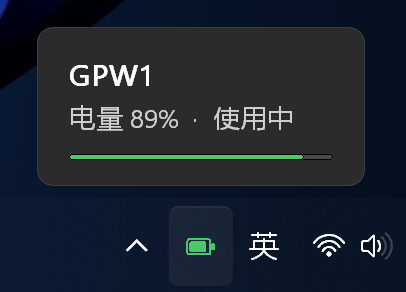

# GPW Battery —— 罗技 GPW（G PRO Wireless 一代）电量托盘工具

纯 Win32 实现（Python + ctypes，**零第三方依赖**），通过罗技 **HID++** 协议直接向
Lightspeed 接收器查询鼠标电量。托盘图标实时显示电量，鼠标悬停弹出仿 Windows 11 原生
tooltip 的深色卡片。

> 不用装 G HUB，不用装 LGSTray，不写服务、不常驻后台进程组，一个 2 MB 的小程序就够了。



## 功能

- **托盘图标显示电量**：电池图形 + 颜色分级（>50% 绿、20~50% 橙、<20% 红、充电中蓝、离线灰）
- **悬停弹窗**：仿 Win11 原生 tooltip 的深色圆角卡片，显示设备名、电量、状态
  - 鼠标在图标上停留 **0.5 秒**才弹出（和系统 tooltip 手感一致），中途移开则不弹
  - 固定在任务栏上方，**不遮挡任务栏**
  - 始终置顶（`WS_EX_TOPMOST`），不会被其它软件窗口盖住
  - 不抢焦点（`WS_EX_NOACTIVATE`）、不出现在 Alt+Tab（`WS_EX_TOOLWINDOW`）
  - 圆角用逐像素 alpha 合成，边缘平滑；高 DPI 下自动缩放
- **右键菜单**：刷新电量 / 开机自启动 / 退出
- 已连接时每 30 秒轮询一次；离线时每 8 秒重试，鼠标一开机就会自动接上
- 鼠标休眠时保留上次数值，不会在「彩色电量」和「灰色离线」之间来回跳

## 下载使用

到 [Releases](../../releases) 下载 `GPWBattery-便携版.zip`，解压后双击 `GPWBattery.exe` 即可，
不需要安装 Python。

⚠️ `GPWBattery.exe` 必须和旁边的 `_internal` 文件夹放在一起，移动时整个文件夹一起搬。

### 首次使用：让图标显示在任务栏上

Windows 11 默认把新出现的托盘图标放进「隐藏的图标」里（任务栏上那个 `^`）。

1. 点击任务栏的 `^` 展开隐藏图标，电池图标就在里面（通常在最前面一格）；
2. 把它**拖到任务栏上**（或右键任务栏 → 任务栏设置 → 其它系统托盘图标 → 打开它）。

固定好之后，鼠标移上去就会弹出电量卡片。

## 从源码运行

需要 Python 3.9+（Windows 10/11），只用标准库，不需要 pip 安装任何东西。

| 命令 | 说明 |
| --- | --- |
| `pythonw gpw_battery.py` / 双击 `启动.bat` | 启动托盘程序 |
| `python gpw_battery.py --once` | 只读一次电量并打印，用于排查 |
| `python gpw_battery.py --once -v` | 打印探测细节（每个设备编号返回的错误码） |
| `python gpw_battery.py --demo` | 用假数据运行，预览弹窗样式 |
| `python hidpp.py -v` | 单独测试 HID++ 通信 |

### 自己打包 exe

```bash
pip install pyinstaller
pyinstaller --noconfirm --onedir --windowed --name GPWBattery gpw_battery.py
```

用 `--onedir` 而不是 `--onefile` 是刻意的：onefile 每次启动都要把自己解压到 `%TEMP%`
再执行，这种「自解压 + 执行临时文件」的行为很容易触发杀软主动防御；onedir 没有这个动作，启动也更快。

## 工作方式

1. 枚举本机 HID 接口，找 `VID_046D` + `usage page 0xFF00` 的罗技厂商通道；
2. 对接收器依次尝试设备编号 `0x01~0x06`（Lightspeed 接收器可以同时带多个设备）；
3. 依次尝试三种电量来源：
   - HID++ 2.0 `0x1000 BATTERY_LEVEL_STATUS`（首选，能同时拿到充电状态与电压）
   - HID++ 2.0 `0x1001 BATTERY_VOLTAGE`（电压法，按锂电曲线换算）
   - HID++ 1.0 寄存器 `0x07`（老设备）
4. 设备名取 `0x0005 DEVICE_NAME`，取不到就显示 `GPW1`。

> 实测 GPW 一代**不支持** `0x1000`，走的是 `0x1001` 电压法（例如 3801 mV → 47%）。

## 常见状态

| 弹窗文字 | 含义 |
| --- | --- |
| `电量 85% · 使用中` | 正常 |
| `电量 60% · 充电中` | 接着线，图标变蓝 |
| `鼠标休眠 · 移动鼠标唤醒` | 接收器正常，鼠标在省电休眠 |
| `鼠标未连接 · 请打开电源` | 接收器正常，鼠标关着或不在范围（底部开关拨到 ON） |
| `接收器无响应 · 请重新插拔` | 接收器没响应，换个 USB 口试试 |

## 启动健壮性

- **开机自启时托盘可能还没就绪**：Explorer 初始化任务栏需要一点时间，此时
  `Shell_NotifyIcon` 会返回 `E_FAIL (0x80004005)`。程序会自动退避重试（最多约 20 秒），不会弹错误框。
- **Explorer 崩溃/重启后图标会消失**：程序监听 `TaskbarCreated` 消息，收到后自动重新挂上图标。
- **真出异常时**：不弹 PyInstaller 的 traceback 对话框，而是把堆栈写到 exe 同目录的
  `GPWBattery-error.log`，静默退出。

## 关于杀毒软件

打包和自启方式都是刻意选过的，避免被误判：

1. **onedir 打包**（见上），规避自解压行为特征；
2. **开机自启不调用 PowerShell**。常见写法是 `powershell -Command "...CreateShortcut..."` 去启动文件夹
   建快捷方式，行为上非常像恶意软件的持久化（脚本宿主 + 写启动项），实测会被卡巴斯基直接删掉宿主 exe。
   本项目改为程序自己写 `HKCU\Software\Microsoft\Windows\CurrentVersion\Run` 下的 `GPWBattery` 值，
   不产生任何子进程。想关掉也可以去「任务管理器 → 启动」里禁用。

如果仍被拦截，把整个程序文件夹加入杀软排除项即可。

## 文件

```
gpw_battery.py   主程序（托盘、弹窗、UI 绘制、轮询）
hidpp.py         罗技 HID++ 协议实现（设备枚举 + 电量读取）
启动.bat         用本机 Python 启动的脚本
```

## 说明

- 只读取电量，不修改鼠标任何设置，不影响 G HUB / LGSTray 等软件同时使用。
- 电量本身在鼠标里是分级上报的（GPW 一代大致 5% 一档），所以数字会跳着变，属于正常现象。
- 卸载：退出程序后直接删掉文件夹；若开过开机自启，先取消勾选（或删掉注册表 `Run` 下的 `GPWBattery` 值）。
- 只在 Windows 10/11 x64 上测试过；理论上其他 HID++ 2.0 罗技鼠标也能用（型号名会显示为 `GPW1`）。

## 许可证

[MIT](LICENSE) © 2026 youyou2858
